# 黑潮行动 / OPERATION BLACKTIDE

基于 Unity 的战术射击项目：俯视角与第一人称、本地训练、服务端权威联机测试场，以及首版 5v5 爆破模式。


*大厅实际场景，使用验证账号。仓库名为 `CrossFire2048`，游戏产品名为 `Operation Blacktide`。*

[快速开始](#快速开始) · [启动面板](#游戏启动面板) · [训练玩法](#训练场与战斗表现) · [爆破模式](#爆破与联机玩法) · [架构设计](#架构设计) · [提交范围](#git-协作与提交范围) · [开发细节](spec/development-guide.md)

## 项目概况

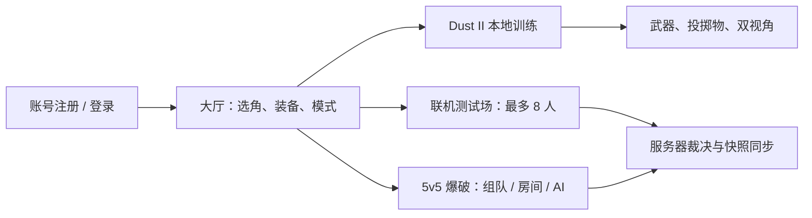

| 部分 | 当前内容 |
| --- | --- |
| 客户端 | Unity **2022.3.47f1c1**、URP **14.0.11**、C#、UGUI |
| 账号与大厅 | .NET 8，注册登录、会话、组队、匹配、房间与战斗进程分配 |
| 战斗服务 | Unity 无窗口进程，公共运动模拟、权威命中与玩法规则 |
| 网络 | 账号/大厅走 TCP；实时战斗使用内嵌 LiteNetLib 包 |
| 开发配套 | Windows 启动面板、配置工作台、实时日志、构建与程序集检查 |

本文图片来自实际项目的场景、界面与验证输出；测试数据、相机输出和布局预览在图下标注。采集日期、历史来源及原图哈希见 [截图来源](ReadMeRes/screenshots/README.md)。截图展示对应版本的画面，不表示所有玩法已有同等功能覆盖。

## 快速开始

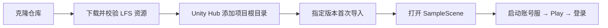

### 环境与首次启动

- 安装 Git 和 [Git LFS](https://git-lfs.com/)。本项目的模型、贴图、音频和字体通过 LFS 保存，打开 Unity 前必须下载完整资源。
- 用 Unity Hub 安装 **Unity `2022.3.47f1c1`**，以 `ProjectSettings/ProjectVersion.txt` 为准。这是带 `c1` 后缀的编辑器版本，协作者应使用相同版本。
- 需要本机注册、登录时，安装 **.NET 8 SDK** 并启动服务端；只打开工程、查看场景不需要服务端。

```powershell
# 首次使用 Git LFS 时安装本机过滤器和钩子。
git lfs install
# 克隆工程；之后的命令均在项目根目录运行。
git clone https://github.com/guzeming/CrossFire2048.git
cd CrossFire2048
# 下载模型、贴图和音频实体，并检查资源完整性。
git lfs pull
git lfs fsck
```

在 Unity Hub 中添加克隆后的项目根目录（包含 `Assets`、`Packages`、`ProjectSettings`），然后使用上述编辑器打开。第一次打开会重新生成 `Library`，并联网恢复包依赖；当前锁定文件使用 `https://packages.unity.cn`。不要把自己的 `Library` 复制给协作者，也不要删除 `packages-lock.json`。

打开 `Assets/Scenes/SampleScene.unity`，点击 Play 进入登录页。注册、登录前，在项目根目录运行：

```powershell
dotnet run --project GServer/OperationBlacktide.Server/OperationBlacktide.Server.csproj -- --port 7777
```

Windows 也可运行 `GTools/run-server.bat`。默认连接 `127.0.0.1:7777`；每位协作者可启动自己的本机服务端。登录后进入 `LobbyScene`，选择训练场进入 `DustII`；直接打开 `Assets/Scenes/DustII.unity` 可用默认角色本地检查训练场。

上述命令仅启动账号服。测试联机/爆破玩法时，优先使用根目录的 `游戏启动面板.bat` 构建客户端、战斗服并启动整套服务；命令行入口为 `GTools/start-local-server.bat`。客户端、账号服和战斗服应使用同一次源码更新构建，不能混用旧协议产物。构建产物不随 Git 克隆提供，首次构建需要时间。

### 已有协作者更新项目

先保存本地改动并关闭 Unity，再更新 `main`：

```powershell
git switch main
# 仅接受快进更新；存在本地未同步提交时，先处理分支差异。
git pull --ff-only origin main
git lfs pull
git lfs fsck
```

更新完成后再用 Unity Hub 打开工程。仓库目录名仍为 `CrossFire2048`，产品名和服务端工程已改为 `OperationBlacktide`；请使用 `GServer/OperationBlacktide.Server/OperationBlacktide.Server.csproj`，不要再引用旧服务端目录。

## 游戏启动面板


*2026-10-22 从启动面板自身重新输出的界面图；服务器状态为截图时的本机状态。*

Windows 下双击根目录 **`游戏启动面板.bat`**。首次自动构建，需要 .NET 8 SDK；生成的 `.lnk` 快捷方式只供本机使用。

- **游戏与服务**：启动游戏、多开客户端、开服后进入游戏，管理本地账号服和战斗服。客户端缺失时先构建；多开测试使用不同账号。
- **构建与检查**：搜索并运行客户端、服务器构建、目录与程序集检查及日志工具自检。任务串行执行，显示阶段、进度、耗时，支持取消。
- **路径与目录**：检测 Unity 版本，也可手动指定编辑器；打开项目、构建产物、日志和构建工作目录。

右上角“使用说明”提供操作帮助。日志在 `Logs/Launcher/`，本机 Unity 路径在 `UserSettings/launcher.json`。关闭启动面板后，已启动的游戏和服务继续运行。默认本地账号服 **TCP 7777**、联机测试场 **UDP 7778**；爆破对局另由账号服分配独立进程与端口。端口占用时先确认旧服务状态，启动面板只停止自己登记并核对身份的托管进程。

## 账户、登录与场景流程


*实际登录面板，截图前已清空账号与密码输入框。*

`SampleScene` 已配置登录 UI。注册、登录及错误提示通过 `AuthClient` 和 TCP 服务完成；成功后由 `GameSceneFlow` 保留会话并切换到大厅。Windows 使用凭据管理器记住最后一次成功登录信息，按服务器区分，仍需点击登录；密码不写入项目文件或 PlayerPrefs。

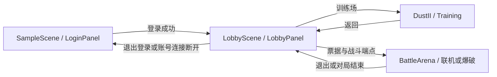

应用服务 `GameSceneFlow`、账号连接和 `UIRoot` 跨场景保留；每个场景的 `GameUIEntry` 负责清理旧面板并打开当前入口。未登录直接进入大厅会返回登录页。`BattleServer.unity` 是服务端启动场景，不作为普通客户端入口。

客户端默认服务器由 `Assets/Scripts/GClient/Runtime/App/AppConfig.cs` 及对应资源配置，开发默认 `127.0.0.1:7777`。账号服控制台支持 `help`、`status`、`accounts`、`clients`、`sessions` 等命令。场景对象组成、预制体登记和凭据验证见 [开发实现细节](spec/development-guide.md)。

## 大厅、角色与装备

| 角色选择 | 双阵营装备配置 |
| --- | --- |
|  |  |

*两张图均为大厅实际界面，使用测试会话；点击图片可查看原图。*

CT / T 各有 5 名角色，支持实时模型、旋转和检视。装备页提供手枪、步枪、狙击、微冲、重型与装备分类，包含经典替换槽位及大厅展示武器选择。

角色与装备按账号保存到本机，两个阵营独立配置。大厅、训练与战斗共用 `EquipmentCatalog`；大厅选择不会绕过联机服务端的装备与购买校验。源目录为 `Assets/Art/Loadout/`，运行时目录为 `Assets/Resources/Loadout/`。

## 训练场与战斗表现

### 俯视与第一人称

| 俯视训练与 HUD | 第一人称持枪 |
| --- | --- |
|  |  |

*左图为训练场实际 UI；右图为第一人称验证器输出的游戏相机画面，不含 HUD。*

| 操作 | 作用 |
| --- | --- |
| WASD / Shift / Space | 移动、疾跑、跳跃 |
| 鼠标 / 左键 / R | 瞄准、攻击、换弹 |
| 右键 | 俯视观察瞄准；支持的狙击武器开镜 |
| 中键拖动 / 滚轮 | 俯视镜头旋转与缩放 |
| P | 切换俯视 / 第一人称 |
| 1 / 2 / 3 / 4 | 训练场主武器、副武器、近战、投掷物；重复按键循环 |
| Esc | 训练菜单、切换武器、返回大厅 |

俯视镜头跟随角色，遮挡建筑可淡化；角色视野与相机遮挡分别处理，建筑透明不等于角色能看穿墙。第一人称锁定鼠标、居中瞄准，使用独立手模相机和持枪、开火、换弹动作。

### 武器、动作与声音


*训练场实际切枪菜单。训练拥有的完整目录不等同于爆破商店的首版装备范围。*

训练目录覆盖 35 把枪械（含电击枪），以及近战与五种投掷物。切枪保留各枪弹匣；训练由玩法显式开启无限补给。射速、弹药、换弹时钟与上半身动作关联，移动和跳跃保留下半身姿态；枪声、分段换弹声、材质命中声和脚步根据实际动作及接触表面触发。

菜单、失焦和暂停会阻断相应输入并暂停训练模拟；退出与重生时清理表现状态。声音采样来源与哈希保存在 `Assets/Art/Combat/` 的来源清单。详细参数、动画构建入口和各类音效规则见 [本地训练实现](spec/development-guide.md#本地训练实现)。

### 投掷物与视野


*投掷物验证在 Dust II 中生成的测试相机画面，隐藏 HUD 以检查效果。*

手雷、闪光弹、烟雾弹、燃烧弹和燃烧瓶支持准备、抛出、碰撞及对应效果。按住左键预览弹道，松开投掷，右键取消；烟雾阻挡目标可见性和激光并可灭火，闪光综合朝向、距离和遮挡。

训练视野结合朝向、墙体与烟雾判断目标显示。当前投掷物和视野主要是本地训练能力，尚未完成投掷物网络权威同步或服务器视野信息裁剪；烟雾使用粒子与遮挡区域。

## 爆破与联机玩法

### 匹配与房间


*实际部署面板的 UI 验证图，队伍使用测试数据；该图未连接匹配服务。*

大厅选择爆破模式后进入部署面板。支持 1–5 人完整组队、队伍号邀请、公开/私密房间、密码、选边准备和房主管理。匹配中显式开启 AI 补齐后等待 30 秒补足十人；自定义房间由房主在满足准备条件后开局。每局使用独立战斗进程，开局固定名单，支持原角色断线重连和对局结束返回队伍或房间。

### 回合、经济与 C4


*2026-10-15 的真实开发版客户端跑测截图：一名脚本控制玩家与九名 AI，保留性能统计叠层；图中帧率仅是当时瞬时值。*

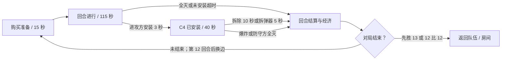

每回合一条命，死亡等待下回合；支持 C4 携带、掉落、拾取、安装与拆除，模型、动作和声音跟随服务端状态。购买由服务器检查资金、阶段和阵营。首版商店覆盖 AK-47、M4A1-S、沙漠之鹰、防弹衣、拆弹器，默认手枪为 Glock / USP。

AI 由服务器控制，能够购买、按路线进攻/守点、取包、安装和拆除。按 **B** 购买、**E** 交互、**Tab** 看战绩，死亡后 **V** 切换己方观战。完整规则、构建方式、AI 战术和现阶段边界见 [爆破模式说明](spec/demolition-mode.md)。

“联机测试场”是另一套练习模式：单房间最多 8 人、单步枪、有限弹药和自动重生，默认可补入七个人机。两种模式的客户端与服务端必须用同一版本源码构建。

## 显示设置与离线助手

| 显示设置 | 大厅助手布局 |
| --- | --- |
|  |  |

*左图为显示设置验证输出；右图为真实助手 UI 叠加已有大厅截图的布局验证，不是完整大厅端到端截图。*

大厅右上角设置可切换全屏、分辨率和性能统计，保存后下次启动恢复；未保存退出时有处理提示。大厅 Esc 打开设置、返回登录或退出游戏的菜单。

离线助手为可选功能。Windows x64 开发环境在根目录运行：

```powershell
powershell -ExecutionPolicy Bypass -File GTools/LocalAssistant/setup.ps1
```

首次联网下载并校验模型与运行时，之后通过 sherpa-onnx 识别、llama.cpp / Qwen 本地对话及 Windows 中文语音完成交互。大厅按 **T** 或点击入口录音，也可打断回复。助手当前只聊天，不执行游戏操作。完整要求和当前安装方式见 [助手说明](GTools/LocalAssistant/README.md)。

模型和运行时在本机 `LocalAssistant/`，不提交 Git；`GTools/LocalAssistant/` 中的实现代码需要提交。普通工程导入、训练和联机不要求安装助手模型。

## 架构设计

### 程序集依赖

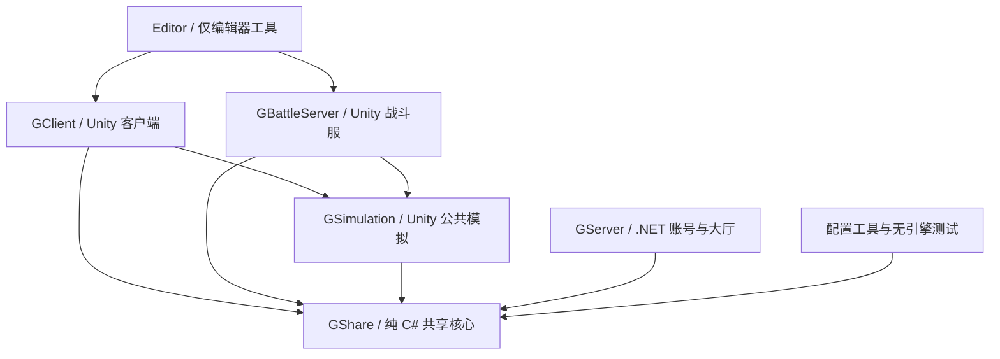

箭头表示代码依赖方向。`GShare` 禁止引擎引用；`.NET` 工程编译同一份共享源码。`GClient` 和 `GBattleServer` 互不引用，二者复用共享规则和 Unity 运动/碰撞适配。普通客户端构建排除战斗服，服务器构建排除客户端。

客户端内部由 `Features` 组合 `Gameplay` 与 `Content`。通用角色、相机、战斗、视野和 HUD 不反向依赖具体玩法；新增模式将目标、计分和回合规则放入自身模块。

### 逻辑对象与表现对象

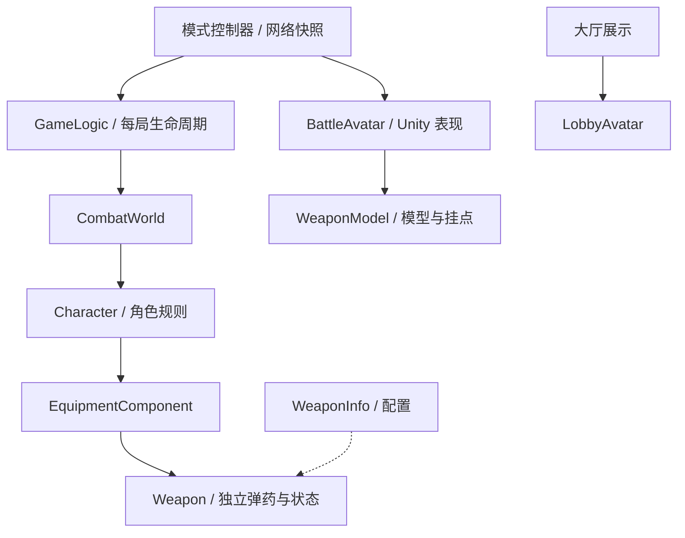

实线表示持有或管理，虚线表示配置输入。共享 `Character` 不持有 Unity 模型、相机或 UI；同类型的两把 `Weapon` 不共享弹药。模式控制器或网络客户端关联逻辑状态与表现对象。宿主在 Start 前装配组件，按依赖顺序初始化与 Tick，退出时逆序释放。

训练在本机运行规则；联机由服务器执行权威规则，客户端预测运动并展示快照。共享源码不代表信任客户端的位置、命中或伤害结果。

### 入场与网络同步

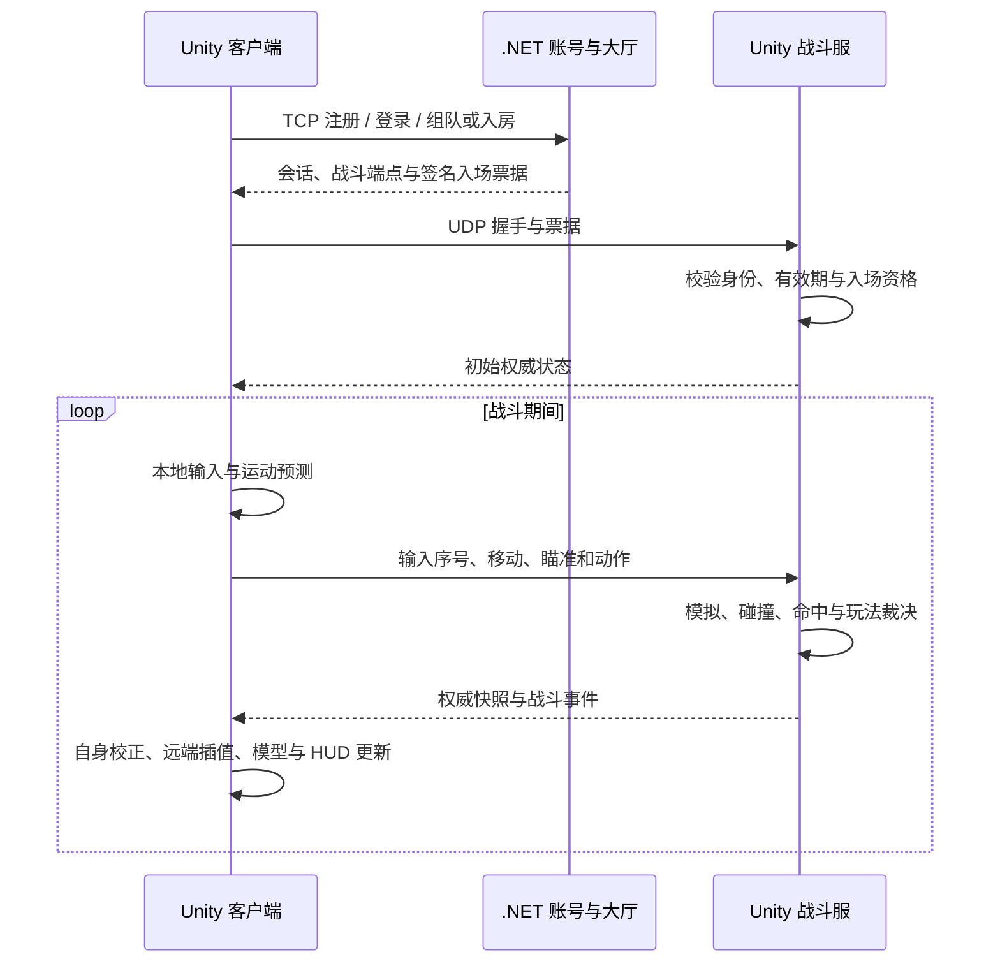

联机测试场已实现 60 Hz 权威模拟、20 Hz 快照、100 ms 远端插值及最多 200 ms 射线回滚。8 人是配置上限，尚不能视为已完成容量压测。爆破使用独立规则、协议与对局进程；密钥和本机账号数据保存在 `data/`，不能进入客户端或仓库。

### UI 与事件流

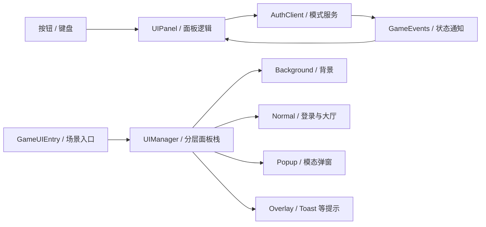

`UIRoot` 提供 Canvas、EventSystem 和跨场景容器，`UIManager` 管理各层面板与返回行为。面板通过 `UIPanelId` 和 `UIPath` 注册，关闭时释放事件订阅。规范见 [UI 设计说明](Assets/Scripts/GClient/Runtime/UI/ui-spec.md)，详细组件与所有权见 [开发实现细节](spec/development-guide.md#组件化架构共享逻辑玩法与表现)。

## 项目目录

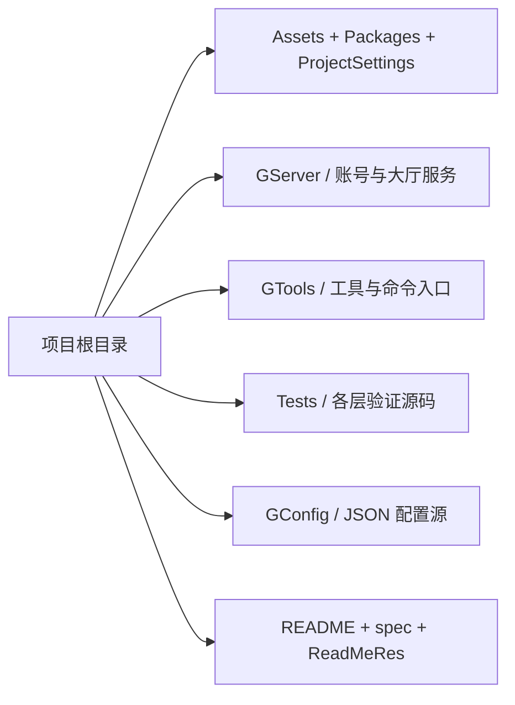

```text
Assets/Scripts/
  GShare/Runtime/              纯 C#；客户端、服务端和工具共用
    Components/               组件宿主与生命周期
    Characters/ Combat/       角色能力、WeaponInfo / Weapon
    AI/Components/            感知、导航、决策
    GameLogic/Components/     每局玩法基座、时钟、重生、补给
    Modes/Demolition/         爆破规则、协议和玩法组件
    Protocol/ Battle/         通信协议和战斗同步数据
  GSimulation/Runtime/
    Movement/ Maps/ Config/   Unity 运动、地图与配置适配
  GClient/Runtime/
    App/ Common/              启动、场景流程、全局事件
    Content/                  公共装备目录、角色/武器模型与动画资源绑定
    Gameplay/                 可复用的 Avatar、战斗、相机、表现组件
    Features/                 Account、Lobby、Training、Battle、Demolition
    Network/ UI/              客户端网络与 UI 基础设施
    Development/              地图查看等开发辅助行为
  GBattleServer/Runtime/
    Hosting/ AI/              权威战斗宿主与 Unity AI 适配
    Modes/Demolition/         爆破战斗服宿主
  Editor/
    Build/ Import/ Inspectors/ 客户端与战斗服共用的 Unity 编辑器工具
GServer/OperationBlacktide.Server/  独立 .NET 账号、大厅与匹配服务
GTools/
  Launcher/ GameConfigEditor/ LogViewer/  独立开发工具
  Common/ DustII/                       工程同步工具、地图导入工具
  build-*.ps1、verify-architecture.ps1  构建和程序集检查入口
Tests/
  Core/                       无引擎共享逻辑验证
  Unity/Architecture/         Unity 程序集与资源引用检查
  Integration/                战斗网络、账号与爆破集成验证
  Tools/                      开发工具和工程同步脚本验证
GConfig/                      跨引擎 JSON 配置源
```

移动 Unity 资源时连同原 `.meta` 一起移动，保留 GUID 并更新字符串加载路径。编辑器工具放 `Editor`，验证源码放 `Tests`，构建与验证入口留在 `GTools`。新增目录应对应明确职责。架构检查入口：`GTools/verify-architecture.ps1`。

## Git 协作与提交范围

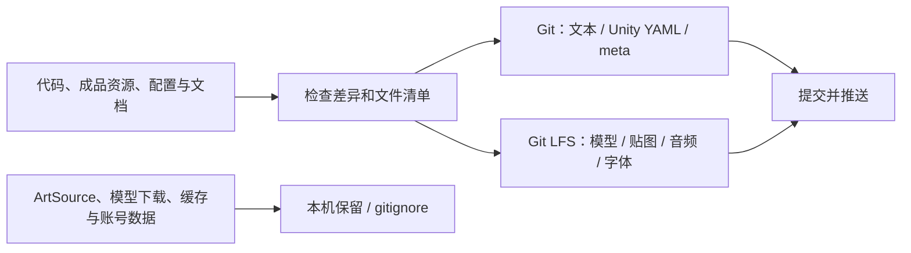

### 哪些文件需要提交

| 路径 | 提交规则 |
| --- | --- |
| `Assets/` | 完整提交资源、脚本及所有对应的 `.meta`，包括目录的 `.meta`；二进制美术资源使用 LFS |
| `Packages/` | 提交 `manifest.json`、`packages-lock.json`，以及 `com.revenantx.litenetlib/` 内嵌包完整源码、元数据和许可证 |
| `ProjectSettings/` | 完整提交，保证编辑器版本、渲染设置、输入设置和构建场景一致 |
| `GServer/` | 提交服务端源码和手写 `.csproj`，排除 `bin/`、`obj/` 和本机账号数据 |
| `GTools/` | 提交开发工具、构建/验证入口及手写 `.csproj`，排除 `bin/obj` |
| `Tests/` | 提交共享逻辑、Unity 和集成验证源码及手写 `.csproj` |
| `GConfig/` | 提交跨引擎 JSON 配置源文件 |
| `ArtSource/` | 整目录仅保留在本地，制作脚本、说明、原始模型、贴图、音效和导出缓存均不提交 |
| `游戏启动面板.bat` | 提交可移植启动入口；本机生成的 `.lnk` 快捷方式不提交 |
| `LocalAssistant/`、`data/` | 本机下载的模型/运行时、账号、服务密钥和进程状态，不提交；`GTools/LocalAssistant/` 中的项目实现代码需要提交 |
| `README.md`、`spec/`、`ReadMeRes/`、`.gitignore`、`.gitattributes` | 提交协作说明、文档及仓库规则 |
| `Library/`、`Temp/`、`Logs/`、`UserSettings/`、`.build-check/`、`.idea/`、`.vs/` | 本机缓存、验证输出或个人配置，不提交 |
| 根目录自动生成的 `.sln`、`.csproj`，以及 `bin/`、`obj/`、构建产物、日志 | 不提交，由 Unity/构建工具重新生成 |
| `.git/` | Git 自行管理；通过 clone/push 同步历史，无需手动上传这个目录 |

移动或重命名 Unity 资源时，要连同原来的 `.meta` 一起操作，避免场景、材质和预制体引用丢失。项目已启用 `Visible Meta Files` 和 `Force Text`。不要给 `.meta`、场景或预制体设置 LFS。

文中出现的 `ArtSource/` 路径均指美术维护者的本地制作工作区，不会随克隆恢复；只有重新制作或导出美术素材时才需要单独取得相关目录。现有场景使用的成品已保存在 `Assets/`。此前跟踪的少量 `ArtSource` 脚本和说明已从当前版本移出，不影响项目导入；旧提交历史未改写。

### 提交前检查

先保存 Unity 工程，再在项目根目录执行：

```powershell
git lfs install --local
git status --short
git add --dry-run .
# 确认清单后，将新增文件、修改和删除一起暂存。
git add -A
git diff --cached --stat
git lfs status
git lfs fsck
git commit -m "更新项目资源与协作配置"
git push origin main
```

`.gitattributes` 会让匹配规则的资源在 `git add` 时自动转成 LFS 指针；`git push` 的 LFS 钩子先上传资源实体，再推送提交。若上传失败，修复原因后重新执行 `git push`，不要跳过 LFS 钩子。团队后续功能开发建议使用分支和合并请求。

当前项目中的已导入资源约 3.05 GiB，首次分享需要上传对应 LFS 对象，协作者首次克隆也需要下载它们。先确认远程仓库的 LFS 存储和下载额度足够。若出现 LFS 下载错误，应先修复下载，再打开 Unity；只拿到代码或 LFS 指针文件不能完整恢复模型和贴图。GitHub 普通 Git 单文件上限为 100 MiB，详见 [GitHub 大文件说明](https://docs.github.com/en/repositories/working-with-files/managing-large-files/about-large-files-on-github)。

原始美术制作工具不是打开项目的前置条件。重建导入资源时才需要额外的原始素材、Blender、Python 和导出工具；相关脚本中的本机工具路径需按各自环境调整。Unity 构建与程序集检查脚本可通过 `-UnityPath` 指定编辑器位置，输出统一留在被忽略的 `.build-check/`。

## 配置工作台与实时日志

| 配置工作台 | 服务器实时日志 |
| --- | --- |
|  |  |

*工具实际界面；日志图来自集成测试，玩家名为测试账号。*

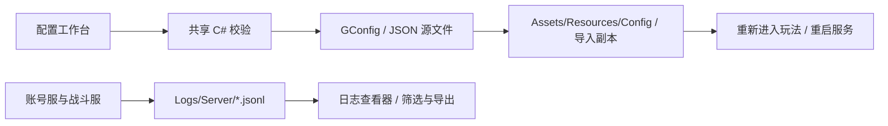

在根目录运行 `dotnet run --project GTools/GameConfigEditor/GameConfigEditor.csproj`，然后打开本机 `http://127.0.0.1:8094`。保存会校验并导出 Unity 配置；不要直接编辑生成副本，运行中的玩法不会热替换配置。武器资源 ID 与模型、动画绑定仍需分别维护。

`GTools/run-log-viewer.bat` 打开日志工具，可按服务、级别、玩家、操作和内容过滤，查看 JSON 或导出。暂停仅停止界面刷新，仍采集日志。服务端记录入场、输入、命中、伤害、死亡及非法输入等事件；历史日志留在本机。

## 构建与检查

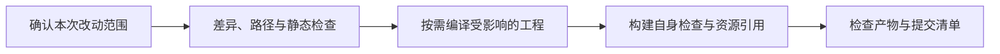

旧的 Unity 玩法、界面、联机客户端回归与性能跑测入口及测试驱动已移除，后续另建专门的验证管线。日常开发按需要做编译和静态检查，保留构建自身的必要检查。源码变更后应重新构建相应客户端和服务端，避免混用旧协议产物。

| 检查目标 | 根目录执行入口 |
| --- | --- |
| 共享组件、配置、武器状态和 AI | `dotnet run --project Tests/Core/CoreValidation.csproj` |
| 账号服务构建 | `dotnet build GServer/OperationBlacktide.Server -c Release` |
| 程序集边界与资源引用 | `GTools/verify-architecture.ps1`；加 `-BuildPlayers` 验证两端构建 |
| 客户端 / 爆破服 | `GTools/build-battle.ps1 -Target Client` / `-Target Demolition` |
| 爆破逻辑 / 真实网络 | `dotnet run --project Tests/Integration/OperationBlacktide.DemolitionTests`；加 `-- --integration` 检查进程联通 |
| 工程同步 / 启动进度协议 | `Tests/Tools/VerifyUnityProject.ps1`、`Tests/Tools/verify-launcher-progress.ps1` |

Unity 构建和程序集检查同步到 `.build-check/` 内独立工程，首次导入可能花费数分钟。`-UnityPath` 可指定本机编辑器，日志由 `GTools/wait-unity-task.ps1` 汇总。表中的独立逻辑与工具测试保留，日常开发不自动运行。

## 当前边界与文档索引

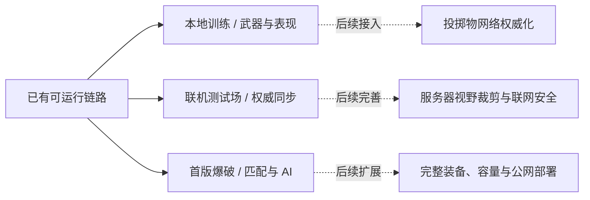

实线为当前实现范围，虚线为后续工作。已有登录、房间、输入上传、快照、预测校正和测试场回滚命中，不再放入“未实现”清单。仍需继续完成投掷物同步、服务器视野裁剪、完整商店与武器拾取、公网部署及容量验证；当前没有排位赛季、加时、选图禁图或反作弊系统。

| 文档 | 内容 |
| --- | --- |
| [开发实现与验证细节](spec/development-guide.md) | 原 README 的组件、场景、资源构建、训练表现与验证细节 |
| [爆破模式](spec/demolition-mode.md) | 规则、协议、组队、进程分配、AI、经济和 C4 |
| [服务端权威迁移规划](spec/server-authority-plan.md) | 后续迁移路线；阅读时与当前实现说明对照 |
| [UI 规范](Assets/Scripts/GClient/Runtime/UI/ui-spec.md) / [网络模块](Assets/Scripts/GClient/Runtime/Network/network-spec.md) | 基础设施职责与约定 |
| [离线助手](GTools/LocalAssistant/README.md) | 可选语音组件的使用与打包 |
| [截图来源](ReadMeRes/screenshots/README.md) | 图片用途、测试限制、采集记录与历史来源 |

维护图文时只提交选中的成品截图到 `ReadMeRes/screenshots/`，同步更新来源清单。架构图使用 Mermaid 源码，功能变化时与说明一起修改；原始美术、下载模型和完整验证输出继续留在本机。
