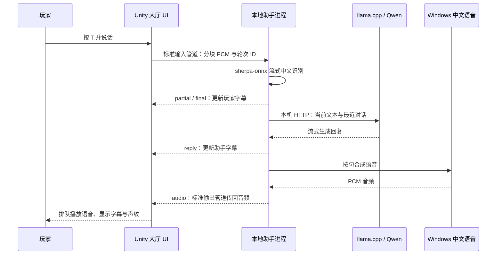
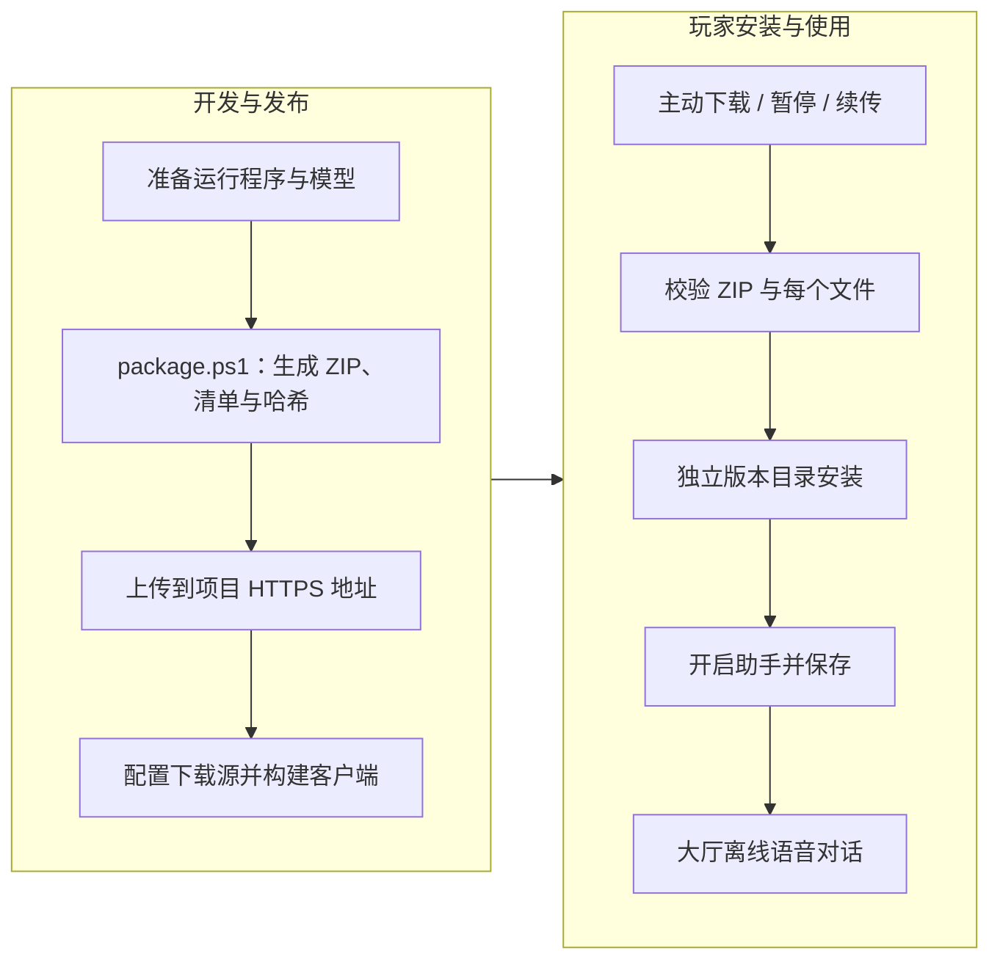

# AI 助手模块：小潮

[返回项目首页](../README.md) · [游戏内界面](game-ui-guide.md#显示设置与离线助手) · [安装与打包说明](../GTools/LocalAssistant/README.md)

小潮是大厅里的可选中文语音助手。玩家通过麦克风说话，助手在本机完成语音识别、生成回复和语音播放，同时显示双方字幕。它可以闲聊、介绍已知的大厅功能入口；目前不替玩家点击界面、控制角色，也不读取实时对局。


*历史 UI 布局验证图：真实助手界面叠加已有大厅截图背景，不是完整大厅端到端截图。图中玩家声纹为青色，助手声纹为金色。来源见 [截图记录](../ReadMeRes/screenshots/README.md)。*

[对话操作](#对话操作) · [安装与启用](#安装与启用) · [处理架构](#处理架构) · [可选组件发布](#可选组件发布集成中) · [代码与资源](#代码与资源) · [当前限制](#当前限制)

## 对话操作

| 操作或状态 | 行为 |
| --- | --- |
| 大厅按 **T**，或点击助手入口 | 开始一轮录音；模型尚未就绪时先等待加载 |
| 录音时再次按 **T** | 提交当前语音，进入识别与回复流程 |
| 说完后停顿 | 识别器结合端点判断结束，静音阈值约 0.8 秒；每轮最长约 30 秒 |
| 助手思考或说话时按 **T** | 取消旧回复，开始新一轮录音 |
| 没有有效语音 | 提示没听清，不把静音当成一次有效对话 |
| 打开弹窗、输入框获得焦点或窗口失焦 | 阻断助手交互并取消正在进行的一轮录音、生成或播放 |
| 关闭助手并保存，或退出大厅 | 停止录音与播放，释放助手及模型进程 |

玩家字幕随识别结果更新，助手字幕随生成结果更新；界面保留当前一轮内容，过长文字显示末尾。声纹由实际输入或播放音频的分段 RMS 驱动，思考阶段显示状态文字。

最近四轮完整对话只保存在助手进程内存中，释放进程后清除。模块不保存玩家录音、字幕或聊天记录；对话不走云端 API。下载组件需要联网，与本地对话是两个独立流程。

## 安装与启用

开发环境需要 Windows x64、麦克风、已安装的 Windows 中文桌面语音，以及构建工具所需的 .NET 8 SDK。在仓库根目录执行：

```powershell
# 首次准备本机运行程序、识别模型和对话模型。
powershell -ExecutionPolicy Bypass -File GTools/LocalAssistant/setup.ps1
```

首次安装会下载并校验模型和推理引擎，输出到本机 `LocalAssistant/`；已准备模型后，可用 `setup.ps1 -SkipModels` 只更新运行程序。Unity 工程导入、训练和联机不要求安装助手。

当前工作区的使用流程是：**设置 → AI 助手 → 安装组件 → 开启助手 → 保存 → 返回大厅按 T 对话**。默认关闭；下载成功不会自动启用，关闭开关也不会删除已安装的模型。

> 版本状态（2026-10-22）：设置页安装流程、整套组件打包及下载基础设施仍在工作区集成，相关代码未随本次文档提交发布。当前组件发布地址 `baseUrl` 为空，未安装玩家会看到“尚未发布”，不能直接下载。现阶段开发者可使用上述 `setup.ps1` 准备本地依赖；正式发行前需要完成组件发布与客户端构建。

## 处理架构



Unity 采集 16 kHz 麦克风音频，通过子进程标准输入/输出交换 JSON 消息；音频以 Base64 PCM 传输。`turn` 标识当前轮次，打断后递增，迟到的旧回复不会覆盖新一轮字幕。

识别使用 **sherpa-onnx + 中文流式 Zipformer small CTC INT8**；对话使用 **llama.cpp + Qwen2.5-1.5B-Instruct Q4_K_M**；语音合成使用本机已安装的 Windows 中文语音。当前默认对话后端使用 Vulkan。模型服务只监听 `127.0.0.1`，每次启动使用随机本机令牌。

助手的加载、监听、思考、说话和错误状态由 `LobbyVoiceAssistant` 管理。关闭设置页与退出大厅有不同作用：前者可以保留后台下载，后者会释放语音对话进程；正在下载的组件由跨场景安装对象单独管理。

## 可选组件发布（集成中）



这套流程把运行程序、llama.cpp、语音识别模型和对话模型封装为一个可选组件。基础游戏只携带清单、下载源配置与下载代码，模型和运行程序不进入 `Assets` 或基础发行包。开发工作区中的打包入口为：

```powershell
# 先准备 LocalAssistant/，再生成一个新的发布版本。
powershell -ExecutionPolicy Bypass -File GTools/LocalAssistant/package.ps1 -Version 1.0.1
```

`package.ps1` 尚未随本次文档提交发布；合入后输出位于 `Builds/OptionalContent/ai-voice/<版本>/`，包含 ZIP、`manifest.json` 和发布说明。当前工作区的 1.0.1 清单记录约 **1.20 GB 下载量、1.34 GB 安装空间**；首次安装还需临时容纳 ZIP 与解压文件，合计约 **2.54 GB**。具体数值以发布清单为准。

下载源使用 `Assets/Resources/Config/OptionalContentSource.json` 的 `baseUrl`；当前留空，不会回退到模型原厂地址。开发用 `setup.ps1` 则从固定上游地址准备依赖。玩家的安装流程校验 ZIP 和逐文件 SHA-256，支持后台限速、暂停、断点续传与重试，成功安装后清理 ZIP 缓存；下载失败不将暂存目录当作可用组件。

| 内容 | 保存与协作规则 |
| --- | --- |
| `GTools/LocalAssistant/` | 助手源码、开发安装脚本和打包实现，随源码提交 |
| `Assets/Resources/Config/AssistantPackage.json`、`OptionalContentSource.json` | 集成中的组件清单与源配置，随对应功能提交和构建 |
| 项目根目录 `LocalAssistant/` | 开发机运行时与模型，保留在本机，不提交 Git |
| `Builds/OptionalContent/` | 待发布组件包，不提交 Git |
| `Application.persistentDataPath/LocalAssistant/` | 玩家下载缓存与版本化安装目录，不提交 Git |

正式发布需上传完整组件，并配置下载地址、保留第三方声明和许可证。当前没有远端清单热更新；修改清单或下载地址后需要重新构建客户端。详细操作随实现维护在 [安装与打包说明](../GTools/LocalAssistant/README.md)。

## 代码与资源

| 入口 | 职责 |
| --- | --- |
| [LobbyVoiceAssistant.cs](../Assets/Scripts/GClient/Runtime/Features/Lobby/LobbyVoiceAssistant.cs) | 大厅挂载、麦克风、状态切换、字幕、音频播放、输入阻断与清理 |
| [LobbyVoiceWaveform.cs](../Assets/Scripts/GClient/Runtime/Features/Lobby/LobbyVoiceWaveform.cs) | 根据实际音频绘制声纹 |
| [LocalAssistantProcess.cs](../Assets/Scripts/GClient/Runtime/Features/Lobby/LocalAssistantProcess.cs) | 本地子进程、消息管道与异步退出 |
| [LocalAssistantSettings.cs](../Assets/Scripts/GClient/Runtime/Features/Lobby/LocalAssistantSettings.cs) | 默认关闭的本机开关、保存与变更事件 |
| [LocalAssistantInstallation.cs](../Assets/Scripts/GClient/Runtime/Features/Lobby/LocalAssistantInstallation.cs) | 查找本地依赖；工作区扩展为跨场景组件安装管理 |
| [Program.cs](../GTools/LocalAssistant/Program.cs) | 识别、对话模型启动、上下文、流式回复、合成与取消 |
| [LobbyAssistant.prefab](../Assets/Resources/UI/LobbyAssistant.prefab) | 助手面板、字幕、按钮与声纹的布局资源 |

界面资源可以直接在 Unity 中编辑。重建入口为 `OperationBlacktide/Lobby/Build Offline Voice Assistant`，大厅由 `LobbyPanel` 挂载助手。下载部分的新通用实现位于工作区 `Content/Packages/`，不承担地图或贴图的流式加载。

## 当前限制

- 当前面向 Windows x64，依赖本机中文语音、麦克风和可运行对应后端的设备；缺少依赖时会给出错误提示。
- 首次模型加载和回复速度取决于设备、模型预热、识别断句及语音合成，不承诺固定响应延迟。
- 中文识别可能出现同音字错误，系统语音自然度有限；聊天回答不能代替游戏内的权威状态或规则数据。
- 没有操作游戏的工具调用，也没有实时读取对局、控制队友或替玩家战斗的能力。战斗 AI 属于另一套服务器模块。
- 下载组件需要联网，安装完整后对话可离线进行；下载过程中不能提前使用尚未安装完成的助手。
