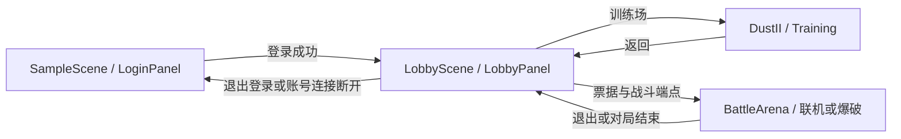

# 游戏内界面介绍

[返回项目首页](../README.md) · [玩法介绍](gameplay-guide.md) · [UI 开发规范](../Assets/Scripts/GClient/Runtime/UI/ui-spec.md)

本文集中展示登录、大厅、选角、装备、显示设置与离线助手。训练 HUD、武器菜单和爆破部署界面随对应玩法说明，见 [训练场](gameplay-guide.md#训练场与战斗表现) 和 [爆破模式](gameplay-guide.md#爆破与联机玩法)。文中的文件路径和命令均以仓库根目录为基准。

[大厅概览](#大厅概览) · [账户与登录](#账户登录与场景流程) · [角色与装备](#大厅角色与装备) · [设置与离线助手](#显示设置与离线助手)

## 大厅概览


*大厅实际场景，使用验证账号。仓库名为 `CrossFire2048`，游戏产品名为 `Operation Blacktide`。*

本文图片来自实际项目的场景、界面与验证输出；测试数据、相机输出和布局预览在图下标注。采集日期、历史来源及原图哈希见 [截图来源](../ReadMeRes/screenshots/README.md)。截图展示对应版本的画面，不表示所有玩法已有同等功能覆盖。

## 账户、登录与场景流程


*实际登录面板，截图前已清空账号与密码输入框。*

`SampleScene` 已配置登录 UI。注册、登录及错误提示通过 `AuthClient` 和 TCP 服务完成；成功后由 `GameSceneFlow` 保留会话并切换到大厅。Windows 使用凭据管理器记住最后一次成功登录信息，按服务器区分，仍需点击登录；密码不写入项目文件或 PlayerPrefs。



应用服务 `GameSceneFlow`、账号连接和 `UIRoot` 跨场景保留；每个场景的 `GameUIEntry` 负责清理旧面板并打开当前入口。未登录直接进入大厅会返回登录页。`BattleServer.unity` 是服务端启动场景，不作为普通客户端入口。

客户端默认服务器由 `Assets/Scripts/GClient/Runtime/App/AppConfig.cs` 及对应资源配置，开发默认 `127.0.0.1:7777`。账号服控制台支持 `help`、`status`、`accounts`、`clients`、`sessions` 等命令。场景对象组成、预制体登记和凭据验证见 [开发实现细节](development-guide.md)。

## 大厅、角色与装备

| 角色选择 | 双阵营装备配置 |
| --- | --- |
|  |  |

*两张图均为大厅实际界面，使用测试会话；点击图片可查看原图。*

CT / T 各有 5 名角色，支持实时模型、旋转和检视。装备页提供手枪、步枪、狙击、微冲、重型与装备分类，包含经典替换槽位及大厅展示武器选择。

角色与装备按账号保存到本机，两个阵营独立配置。大厅、训练与战斗共用 `EquipmentCatalog`；大厅选择不会绕过联机服务端的装备与购买校验。源目录为 `Assets/Art/Loadout/`，运行时目录为 `Assets/Resources/Loadout/`。

## 显示设置与离线助手

| 显示设置 | 大厅助手布局 |
| --- | --- |
|  |  |

*左图为显示设置验证输出；右图为真实助手 UI 叠加已有大厅截图的布局验证，不是完整大厅端到端截图。*

大厅右上角设置可切换全屏、分辨率和性能统计，保存后下次启动恢复；未保存退出时有处理提示。大厅 Esc 打开设置、返回登录或退出游戏的菜单。

离线助手为可选功能。Windows x64 开发环境在根目录运行：

```powershell
powershell -ExecutionPolicy Bypass -File GTools/LocalAssistant/setup.ps1
```

首次联网下载并校验模型与运行时，之后通过 sherpa-onnx 识别、llama.cpp / Qwen 本地对话及 Windows 中文语音完成交互。大厅按 **T** 或点击入口录音，也可打断回复。助手当前只聊天，不执行游戏操作。完整要求和当前安装方式见 [助手说明](../GTools/LocalAssistant/README.md)。

模型和运行时在本机 `LocalAssistant/`，不提交 Git；`GTools/LocalAssistant/` 中的实现代码需要提交。普通工程导入、训练和联机不要求安装助手模型。

