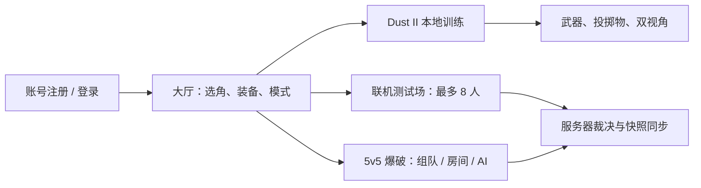
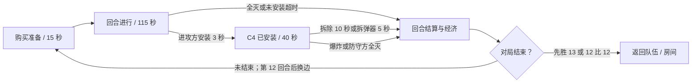
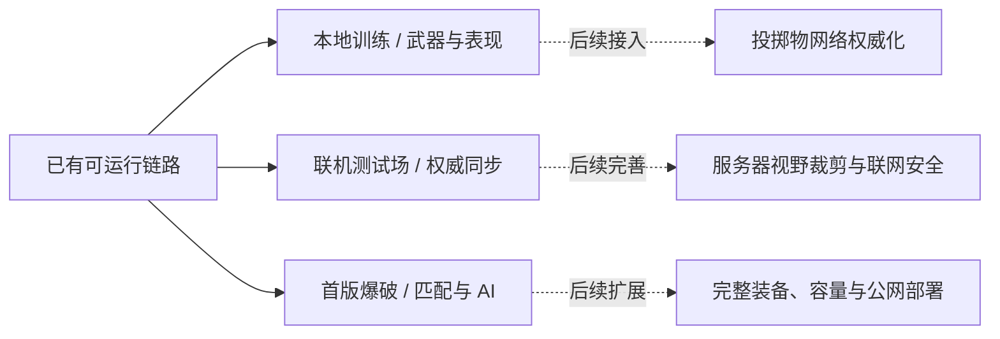

# 玩法介绍

[返回项目首页](../README.md) · [游戏内界面](game-ui-guide.md) · [开发实现细节](development-guide.md)

本文介绍本地训练、联机测试场与爆破模式，保留操作说明、游戏截图和玩法流程图。文中的文件路径和命令均以仓库根目录为基准。

[模式概览](#模式概览) · [训练场与战斗表现](#训练场与战斗表现) · [爆破与联机玩法](#爆破与联机玩法) · [当前实现与边界](#当前实现与边界)

## 模式概览

本文图片来自实际项目的场景、界面与验证输出；测试数据、相机输出和布局预览在图下标注。采集日期、历史来源及原图哈希见 [截图来源](../ReadMeRes/screenshots/README.md)。截图展示对应版本的画面，不表示所有玩法已有同等功能覆盖。

## 训练场与战斗表现

### 俯视与第一人称

| 俯视训练与 HUD | 第一人称持枪 |
| --- | --- |
|  |  |

*左图为训练场实际 UI；右图为第一人称验证器输出的游戏相机画面，不含 HUD。*

| 操作 | 作用 |
| --- | --- |
| WASD / Shift / Space | 移动、疾跑、跳跃 |
| 鼠标 / 左键 / R | 瞄准、攻击、换弹 |
| 右键 | 俯视观察瞄准；支持的狙击武器开镜 |
| 中键拖动 / 滚轮 | 俯视镜头旋转与缩放 |
| P | 切换俯视 / 第一人称 |
| 1 / 2 / 3 / 4 | 训练场主武器、副武器、近战、投掷物；重复按键循环 |
| Esc | 训练菜单、切换武器、返回大厅 |

俯视镜头跟随角色，遮挡建筑可淡化；角色视野与相机遮挡分别处理，建筑透明不等于角色能看穿墙。第一人称锁定鼠标、居中瞄准，使用独立手模相机和持枪、开火、换弹动作。

### 武器、动作与声音

*训练场实际切枪菜单。训练拥有的完整目录不等同于爆破商店的首版装备范围。*

训练目录覆盖 35 把枪械（含电击枪），以及近战与五种投掷物。切枪保留各枪弹匣；训练由玩法显式开启无限补给。射速、弹药、换弹时钟与上半身动作关联，移动和跳跃保留下半身姿态；枪声、分段换弹声、材质命中声和脚步根据实际动作及接触表面触发。

菜单、失焦和暂停会阻断相应输入并暂停训练模拟；退出与重生时清理表现状态。声音采样来源与哈希保存在 `Assets/Art/Combat/` 的来源清单。详细参数、动画构建入口和各类音效规则见 [本地训练实现](development-guide.md#本地训练实现)。

### 投掷物与视野

*投掷物验证在 Dust II 中生成的测试相机画面，隐藏 HUD 以检查效果。*

手雷、闪光弹、烟雾弹、燃烧弹和燃烧瓶支持准备、抛出、碰撞及对应效果。按住左键预览弹道，松开投掷，右键取消；烟雾阻挡目标可见性和激光并可灭火，闪光综合朝向、距离和遮挡。

训练视野结合朝向、墙体与烟雾判断目标显示。当前投掷物和视野主要是本地训练能力，尚未完成投掷物网络权威同步或服务器视野信息裁剪；烟雾使用粒子与遮挡区域。

## 爆破与联机玩法

### 匹配与房间

*实际部署面板的 UI 验证图，队伍使用测试数据；该图未连接匹配服务。*

大厅选择爆破模式后进入部署面板。支持 1–5 人完整组队、队伍号邀请、公开/私密房间、密码、选边准备和房主管理。匹配中显式开启 AI 补齐后等待 30 秒补足十人；自定义房间由房主在满足准备条件后开局。每局使用独立战斗进程，开局固定名单，支持原角色断线重连和对局结束返回队伍或房间。

### 回合、经济与 C4

*2026-10-15 的真实开发版客户端跑测截图：一名脚本控制玩家与九名 AI，保留性能统计叠层；图中帧率仅是当时瞬时值。*

每回合一条命，死亡等待下回合；支持 C4 携带、掉落、拾取、安装与拆除，模型、动作和声音跟随服务端状态。购买由服务器检查资金、阶段和阵营。首版商店覆盖 AK-47、M4A1-S、沙漠之鹰、防弹衣、拆弹器，默认手枪为 Glock / USP。

AI 由服务器控制，能够购买、按路线进攻/守点、取包、安装和拆除。按 **B** 购买、**E** 交互、**Tab** 看战绩，死亡后 **V** 切换己方观战。完整规则、构建方式、AI 战术和现阶段边界见 [爆破模式说明](demolition-mode.md)。

“联机测试场”是另一套练习模式：单房间最多 8 人、单步枪、有限弹药和自动重生，默认可补入七个人机。两种模式的客户端与服务端必须用同一版本源码构建。

## 当前实现与边界

实线为当前实现范围，虚线为后续工作。已有登录、房间、输入上传、快照、预测校正和测试场回滚命中，不再放入“未实现”清单。仍需继续完成投掷物同步、服务器视野裁剪、完整商店与武器拾取、公网部署及容量验证；当前没有排位赛季、加时、选图禁图或反作弊系统。

