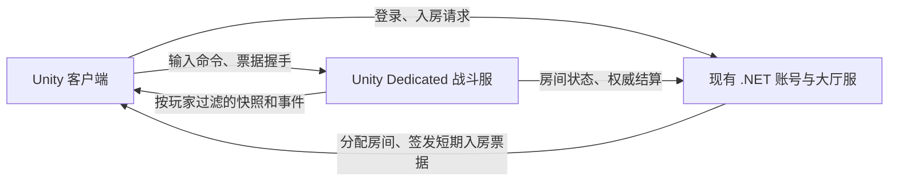

# 服务端权威战斗迁移方案

日期：2026-10-07。状态：方案草案，尚未实现权威战斗。

目标：客户端提交操作意图，可信服务端计算比赛结果，并决定每位玩家能获得哪些信息。客户端保留即时操作反馈、预测和表现。首个验收场景为两个客户端、一个房间、一张简化碰撞地图、一把步枪；以未来 5v5 作为暂定容量假设，实际人数和服务器规格需在压测前确定。

## 1. 当前缺口

最近的目录重构解决了跨模式复用，但没有改变战斗权威归属。

| 现有入口 | 当前行为 | 权威化时需要改变的部分 |
| --- | --- | --- |
| `Gameplay/Characters/CharacterMotor.cs` | 读取输入、相机瞄点，按本地帧时间移动 | 分开输入、固定步长运动和表现；服务端维护位置、速度、落地状态 |
| `Gameplay/Combat/WeaponController.cs` | 本地扣弹、射线命中并直接调用 `ApplyDamage` | 拆开开火请求、规则模拟、命中查询和视觉反馈 |
| `Gameplay/Combat/MeleeController.cs` | 本地决定攻击时点和近战命中 | 服务端判断冷却、有效动作阶段、距离和遮挡 |
| `Gameplay/Combat/ThrowableWorld.cs` | 每个本地玩家创建投掷物世界，随输入阻断/失焦暂停 | 每个房间一个权威世界，由服务端时钟持续推进 |
| `Gameplay/Combat/CharacterVitals.cs`、`Damageable.cs` | Unity 对象保存并修改血量 | 联机客户端只接受权威状态；受伤接口成为本地模式/服务端模拟的适配层 |
| `Gameplay/Vision/CharacterVision.cs` | 客户端对已存在的目标隐藏 Renderer | 独立的服务端可见性规则与按接收者过滤的消息 |
| `Features/Lobby/LobbyLoadoutStore.cs` | PlayerPrefs 保存装备偏好 | 只作为选择意图；所有权、阵营、模式、购买与数量由服务端校验 |
| `GShare/Runtime/Combat` | 已有纯 C# 弹药和射速状态类 | 可以复用规则代码；共享代码不代表信任客户端计算结果 |
| `GServer/.../GameServer.cs`、`MessageType.cs` | 注册、登录、心跳 | 新增入房授权、战斗连接和房间生命周期 |

当前 Socket 连接直接使用 `NetworkStream`，尚无 TLS。公网开放前，应补齐安全传输、消息长度上限、超时和速率限制；这与战斗权威是两项独立工作。

## 2. 权威边界

| 逻辑 | 服务端最终负责 | 客户端可以负责 |
| --- | --- | --- |
| 移动、跳跃、疾跑、碰撞 | 速度、位置、重力、落地、模式限制 | 输入采集、自身运动预测、误差修正 |
| 朝向、开镜 | 合法输入、武器开镜资格、开镜移速、逻辑朝向 | 鼠标映射、镜头旋转、镜头过渡、准星 |
| 射击、换弹、切枪 | 持有武器、射速、弹药、装填时间、切换状态 | 立即播放枪口、声音和动作；显示可校正的预计弹药 |
| 子弹与近战 | 逻辑出手位置、射线/碰撞、射程、遮挡、伤害 | 曳光、弹孔、挥刀表现；命中确认以服务端事件为准 |
| 血量、护甲、死亡、重生 | 唯一真实状态和模式规则 | 显示状态、受击动画和音效 |
| 投掷物 | 库存、释放时点、轨迹、反弹、引信、爆炸、持续伤害 | 预览弹道、预测出手、插值、粒子和音效 |
| 烟雾、闪光 | 生效区域、持续时间、遮挡和受影响状态 | 粒子、白屏、灰雾、耳鸣 |
| 角色视野 | 哪些敌人状态/事件允许下发 | 环境压暗、软边、渲染与镜头建筑透明 |
| 装备、购买、炸弹、回合 | 所有权、经济、安装拆除条件、胜负和结算 | 菜单选择与进度展示 |

联机模式下，客户端发“按住开火、朝这个方向瞄准、请求换弹”，不能直接提交具有权威效力的目标 ID、伤害值、剩余子弹、出生位置或爆炸结果。
修改本地动画、时间缩放或 PlayerPrefs 不能改变服务器的运动、射速、装备和结算。玩家身份从已认证连接取得，不能由请求正文中的 `userId` 或 `entityId` 自由指定。

## 3. 建议的服务端形态

建议保留现有 .NET `GServer` 作为账号/大厅服务，新增 Unity Dedicated 战斗服，由我们控制的服务器进程运行，客户端连接对应房间。



这是基于现有工程的建议：当前碰撞、角色运动、射击和投掷物都依赖 Unity 物理；复用碰撞资源和 Unity 运行时，可以减少迁移时重写物理查询的工作。Unity 2022.3 提供 Dedicated Server 构建目标，支持桌面平台并针对服务端资源开销进行优化。[Unity 2022.3 Dedicated Server](https://docs.unity3d.com/2022.3/Documentation/Manual/dedicated-server-introduction.html)

| 路线 | 适合当前项目的收益 | 必须承担的成本 |
| --- | --- | --- |
| .NET 账号服 + Unity Dedicated 战斗服（建议） | 延续现有账号服务，复用 Unity 地图碰撞和物理查询 | 两种进程的构建部署；拆除模拟对相机、动画、音频、UI 的依赖；测量单房内存和 CPU |
| 全部使用纯 .NET 战斗服 | 统一运行环境，能独立优化模拟实现 | 导出地图碰撞数据，接入另一套碰撞/物理实现，适配角色台阶、斜坡、跳跃和投掷反弹；验证客户端与服务端差异 |

P0 用可运行的服务端构建确认推荐路线。暂不指定网络库版本，也不把整个工程改成 DOTS；实际传输库需验证 Unity 2022.3、目标平台、可靠消息和安全通道支持。

专服必须有独立启动入口和服务器地图：包含碰撞体、出生点、交互区、视野遮挡数据，避免启动登录 UI、客户端相机、完整外观和粒子池。Dedicated Server 的资源剥离不等于业务解耦，且 Resources 资源可能被保留，需检查真实构建产物。[Unity 服务端优化说明](https://docs.unity3d.com/2022.3/Documentation/Manual/dedicated-server-optimizations.html)

## 4. 代码边界与迁移方式

以下为拟建结构，不表示目录或功能已实现：

```text
Assets/Scripts/
  GShare/Runtime/
    Protocol/Battle/        输入、快照、事件、协议版本
    Simulation/            纯 C# 状态、规则、ID、时钟约定
    Combat/                现有 AmmoState、FireControl
  GSimulation/Runtime/     依赖 Unity 的公共模拟、碰撞适配、逻辑命中体
  GBattleServer/Runtime/   专服启动、房间循环、命令校验、历史状态、信息裁剪
  GClient/Runtime/
    Gameplay/              现有客户端输入、预测适配、相机与表现
    Network/Battle/        输入发送、快照接收、预测校正、远端插值
    Features/Training/     本地训练模式与场景组装
GServer/OperationBlacktide.Server/
  Rooms/                   房间分配和入房票据；最终结算入口
```

依赖方向：客户端和 Unity 战斗服都可引用 `GSimulation` 与 `GShare`；`GSimulation` 不引用 `GClient`、UI、相机或训练模式；.NET 账号服只引用纯 C# `GShare`。按这些实际边界增加必要程序集与服务端编译条件，不为每个小组件单独建程序集。

具体拆分：

1. `CharacterMotor` 拆成输入适配、固定步长运动模拟、Transform/动画展示。运动模拟接受明确输入与服务端步长，不读取 `Input`、`Screen` 或相机对象。
2. `WeaponController` 拆成武器状态模拟、命中服务和表现。武器规则用纯数值配置；动画、音效、材质留在客户端配置，双方以稳定 ID 关联。服务端从自己的配置加载射速、伤害和容量。
3. 使用逻辑枪口/近战体积/角色命中体，而不是读取渲染骨骼作为权威出手位置。先采用现有头部/躯干简化体积，明确姿态与开火方向规则；表现骨骼跟随模拟。
4. `ThrowableWorld` 拆为房间级模拟和客户端效果层。投掷动作的权威准备/释放时间来自规则配置；动画事件只消费这些时点。失焦、打开菜单或单个角色死亡不能暂停房间时钟。
5. 将血量与生命阶段保存到模拟实体，联机客户端通过快照更新状态视图。现有 `Damageable` 保留为 Unity 适配接口，禁止网络包直接调用客户端扣血后再上传结果。
6. `CharacterVision` 的环境渲染保留；服务端单独实现视野规则和网络过滤，不运行 Shader 或 Renderer 隐藏逻辑。
7. 本地训练使用明确的本地运行入口；联机入口不能因为掉线、票据失败或收到客户端参数而切换成本地权威。训练补给规则由本地模式或服务端房间配置授予。

地图、武器规则和协议均有版本，服务器选择实际内容；客户端上报的版本仅用于兼容性检查，不能证明客户端未被修改。共享代码也不保证 Unity 物理在不同平台完全一致，预测系统必须允许服务端校正。

## 5. 输入、模拟与同步

建议的初始参数：模拟 60 tick/s，输入最多每秒 60 次，快照每秒 20 次；远端插值缓冲先试 100 ms，最大回滚窗口先试 200 ms。它们都是原型起点，需根据实测 RTT、抖动、带宽和服务器负载调整。

### 输入命令

`InputCommand` 拟包含序号、客户端 tick 提示、移动轴、瞄准角度、按键状态/边沿，以及请求切换的装备槽位。视角信息是操作输入，服务端仍需检查数值范围和游戏规则；不能靠限制角度证明瞄准来自真人。

服务端按自己的时钟每步执行至多规定数量的输入。客户端不传具有权威效力的 `deltaTime`，增加消息数量不能增加模拟时长或射击次数。批量和冗余输入有严格上限；重复序号丢弃，乱序只在有界窗口内处理，过旧/异常超前命令拒绝。丢包不能重复触发跳跃、投掷、切枪等一次性动作；持续输入有短期保持上限，长时间未收到输入后归零。

### 快照与事件

`WorldSnapshot` 带服务端 tick、快照序号和当前客户端最后已处理输入序号，包含其有权获得的实体状态。客户端保存未确认输入，收到自身状态后从权威状态重放，平滑展示修正；其他角色采用快照插值。

命中、死亡、投掷出手、回合转换等事件带唯一事件 ID 和发生 tick，用于去重和与快照对齐。客户端可先表现自己开火，但确认伤害、击杀和胜负必须等待服务器。预测事件与权威确认关联，防止一枪播放两次。

账号/大厅继续采用可靠连接；战斗采用支持有序不可靠消息与必要可靠通道的成熟 UDP 传输方案。高频过期快照不重发，关键状态通过可靠事件或后续完整状态收敛。先完成基础鉴权与输入约束，再开放任何远程测试；不直接把逐帧 JSON 接进当前账号消息循环。

### 命中回滚

服务端保存有界历史命中体和必要的遮挡状态，用经校验的命令时间与网络时间估计查询历史。客户端时间戳只作提示，不能任意选择过去的目标位置。重复、过期和超前射击不得产生额外伤害，回滚查询不能改变当前权威状态。

首版在静态墙体地图验证射线武器。动态门、移动掩体、姿态切换和重生边界加入后必须有对应历史策略；不能把旧人物命中体和不匹配的当前遮挡随意组合。弹药、射速和生命阶段仍由服务器保证一次性与时序约束，历史命中不能重复扣血。Valve 的公开说明展示了预测、插值和服务端回滚配合解决延迟的方式；本项目参数需要独立测试。[Source 网络同步说明](https://developer.valvesoftware.com/wiki/Source_Multiplayer_Networking?language=uk)

## 6. 防透视需要信息下发控制

现有客户端已持有目标对象，再设置 `forceRenderingOff` 只能控制正常画面。联机时，应在服务端按接收者构造快照和事件：不该获知的敌人，不下发实时位置、朝向、骨骼和装备更新。Riot 的 Fog of War 方案同样把限制客户端可获得的信息作为防透视的一层。[Riot Fog of War 技术说明](https://www.riotgames.com/en/news/demolishing-wallhacks-valorants-fog-war)

本项目的判定基础为服务端角色位置/逻辑朝向、视距、周边感知、墙体、烟雾和闪光状态。开镜延长视距需服务端确认；改变本地相机高度、透明墙体或禁用视野脚本不能扩大下发范围。

需要明确的边界：

- 可见性负责信息权限，不直接禁止盲射或烟雾内射击；能否命中由真实物理和武器规则决定。
- 为避免转角人物突然出现，需要保守可见性预测与有界提前下发；这会形成少量信息暴露窗口，不能宣称零透视。
- 玩家已见过的历史位置不能从其记忆中收回，但失去可见性后不应继续发送实时轨迹。退出/重新进入可见范围使用明确的显隐生命周期和新基线。
- 枪声、脚步、命中特效、抛壳、HUD、观战、录像及调试消息都可能泄露位置；必须使用相同权限规则。听觉信息按玩法需要发送，明确是否允许精确声源坐标，不附带不必要的隐藏实体状态。
- 闪光白屏可以被恶意客户端关闭，因此完全失明时的信息限制也要由服务端执行。客户端已缓存的画面/历史信息仍然存在，不能承诺完全消除收益。
- 若敌方精确血量不是玩法公开信息，不把它放进公共快照；死亡观战采用所属阵营/房间规则授权，不能提前给所有客户端发送全图状态再本地隐藏。

## 7. 接入安全与诊断

入房票据至少绑定账号、房间、到期时间、随机数和协议版本。由可信服务签发，通过安全握手一次性消费或绑定到指定会话；客户端不持有签发密钥。重连重新校验会话，不能复用旧序号执行过去动作。战斗服向账号服提交结算也必须认证，并用对局 ID 去重。

数据处理顺序为：传输鉴权 → 包长度/类型检查 → 连接与房间身份 → 数值与序号检查 → 当前角色状态/装备规则 → 固定步长模拟。检查 NaN/Infinity、越界索引、伪造实体、重复事件、洪泛和跨房间请求；解码与命令队列必须有容量上限。

记录对局、连接、实体、输入序号、服务端 tick、拒绝原因和关键判定，保留有界回放数据。先拒绝非法操作并记录证据，不因单次延迟、失步或异常包直接永久封禁。服务器权威能阻止修改伤害、子弹、速度等直接篡改，但合法视野内的自瞄和自动操作仍需要后续检测、回放和处置体系。

## 8. 分阶段落地与完成标准

| 阶段 | 实施内容 | 完成标准 |
| --- | --- | --- |
| P0：专服与模拟拆分验证 | 明确服务器构建入口、裁剪地图、固定步长时钟、纯数据规则、逻辑命中体；验证传输方案和目标平台 | 无图形服务端独立加载简化地图并运行运动/射线测试；不依赖输入、相机、UI、音频、动画采样或窗口焦点；记录 CPU/内存基线 |
| P1：最小移动联机 | 房间与实体 ID、票据握手、输入协议、快照、自身预测校正和他人插值；一进程一房间起步 | 两个客户端看到一致位置；客户端传送、改时间或刷输入不能改变权威速度/位置；断线与序号重复有明确处理 |
| P2：单武器权威战斗 | 一把步枪、有限弹药、换弹、切枪约束、服务端命中/伤害/死亡、授权出生；加入有界射线回滚 | 双客户端生命与弹药一致；伪造伤害、射速、弹量、枪口、未持有武器和旧时间戳无效；掩体与延迟用例通过 |
| P3：近战与投掷物 | 近战、手雷、燃烧、烟雾、闪光，房间级模拟与库存管理 | 爆炸/持续伤害一次性结算；反弹和引信可回放；打开菜单、失焦或恶意减速不暂停房间；客户端关闭烟雾/白屏不能改变服务端状态 |
| P4：信息裁剪与公网门槛 | 按玩家可见性过滤、显隐基线、声音/命中事件权限、观战限制；包大小/速率限制、安全传输与压力测试 | 修改客户端显示隐藏对象后，仍拿不到未授权敌人的实时状态；全链路抓包/事件检查无旁路泄露；容量与异常包测试通过 |
| P5：完整模式与规模化 | 炸弹、购买、回合、胜负、重连恢复和可信结算；按压测结果决定多房间进程及部署方式 | 安装/拆除由服务端校验距离、存活、持有物、持续时间；结算幂等；跨房状态不串扰 |

从 P0 就预留按接收者构造快照的接口和字段权限；P4 是完整信息裁剪验收阶段，不应等到所有同步代码写完才加入权限概念。P1–P3 只用于受控开发测试，不能视为已具备公开竞技对战的安全门槛。

每个阶段分别验收，不同时迁移所有武器与完整爆破流程。首个开发交付建议限定 P0–P2：两客户端能够移动、射击、换弹、受伤与死亡，并能用伪造输入测试证明服务端掌握最终结果。

## 9. 验证清单

- [ ] 固定输入序列验证弹药、冷却、换弹、伤害、死亡与事件去重；客户端预测重放不重复产生业务事件。
- [ ] 两客户端在 RTT 0/50/100/150 ms、抖动和 1%/5% 丢包下进行移动、贴墙、跳跃、开火和重连测试；数字为测试档位，不是性能承诺。
- [ ] 覆盖越界时间戳、重复/乱序命令、输入洪泛、超速、空弹射击、跨角色/跨房操作和未授权装备。
- [ ] 在遮挡、烟雾、完全闪光、转角、开镜、队友和死亡观战情形下检查接收端实际得到的数据，而不只看截图。
- [ ] 投掷物多碰撞体去重、持续伤害频率、丢失释放消息、取消投掷、重连与菜单失焦测试。
- [ ] 记录指定机器上目标人数、最坏投掷物/烟雾数量的 tick 耗时分位数、内存、带宽和快照尺寸；持续超过 tick 时间预算时不得发布该容量配置。
- [ ] Windows 开发客户端与目标平台专服进行实际互通和物理误差测试；保存规则/地图版本与关键日志，帮助定位预测偏差。
- [ ] 保留现有本地训练回归；离线成绩不能写入联机竞技结算。

## 10. 首个实现记录（2026-10-07）

已落地 P0–P2 的基础闭环：.NET 账号服签发 HMAC 短时一次性票据；LiteNetLib 2.1.4 使用嵌入包源码；`Blacktide.Shared`、`Blacktide.Simulation`、`Blacktide.BattleServer` 分别约束纯规则、Unity 模拟和权威服务端依赖。客户端通过大厅进入独立的联机测试场。

服务端独立固定步长运行移动、碰撞、开火冷却、有限弹药、换弹、射线伤害、死亡和定时重生。客户端只发送有界输入，不发送位置、伤害、命中目标或枪口。自身预测重放只执行运动，不重复结算射击。远端插值延迟 100 ms；射线回滚取服务端测得 RTT 的一半加插值延迟，最多 200 ms，不采用客户端提供的历史时间。回滚检查生命版本，避免命中新一轮重生。快照按接收者构造，其他玩家的弹量和输入确认序号不下发。

当前交付为同机回环地址开发验证，单房间、简化地图、单步枪。无 Dedicated Server 模块时构建 Windows Mono 无窗口服；资源剥离、完整地图/武器迁移、完整时延与误差量化、容量压测，以及 P3–P5 仍未完成。完整视野裁剪之前，房间位置和射击事件仍然广播，不能用于公开竞技运营；账号会话撤销尚未联动独立战斗服。

新增 `OperationBlacktide.LogViewer`：实时读取账号/战斗 JSONL，支持玩家、操作、服务与级别筛选、暂停、自动滚动、详情和导出；日志有房间、身份、实体、tick、输入序号，不记录令牌或密码。操作日志按状态变化和实际战斗事件记录，拒绝日志聚合限频。

实测：两个网络客户端及 Unity 预测/渲染客户端通过移动、掩体碰撞、开火、伤害、死亡、重生和换弹用例；匿名/伪造/重放票据、伪造射击消息、NaN 和输入洪泛被拒绝或限速。50 ms + 1% 丢包、100/150 ms + 5% 丢包的移动检查通过，这不代替全套延迟战斗验收。日志解析器通过 UTF-8 分片、半行、截断、滚动新文件与坏行测试；本地启动/停止均通过并记录退出事件。当前机器上无玩家战斗服工作集约 145 MiB，空闲两秒累计 CPU 约 141 ms；这是一次开发机采样，不是容量承诺。

启动、停止、构建与验证方式见 README 的“联机测试场与实时日志”。验证结果应以实际日志为准，以上记录不把整个原规划清单视为全部完成。
